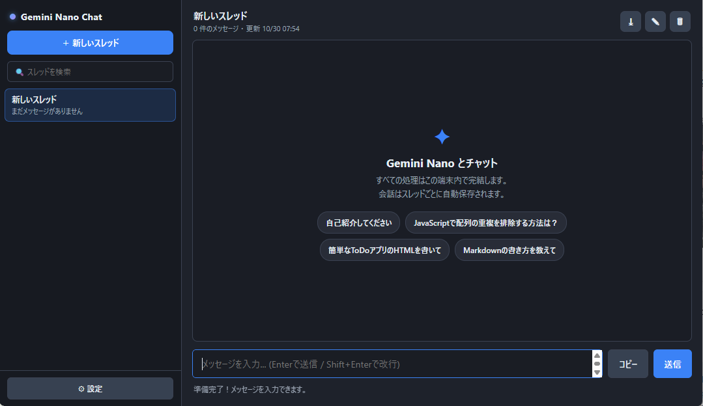

# Local Gemini Nano Chat

Chrome に内蔵された **Gemini Nano（Prompt API）** とチャットするための、`index.html` + `app.js` の 2 ファイルで完結するローカルチャットツールです。サーバーもビルドも不要で、会話はすべて端末内（ブラウザ）で完結します。

- スレッドを複数持てる／履歴は自動保存・切替可能
- コードブロックに「コピー」ボタン
- 生成の停止・回答の再生成・Markdown / JSON エクスポート
- システムプロンプトと温度（temperature）の設定



---

## 1. 動作環境

| 項目   | 要件                                                  |
| ---- | --------------------------------------------------- |
| ブラウザ | Google Chrome（Gemini Nano / Prompt API が利用可能なバージョン） |
| モデル  | Gemini Nano（==🔴**初回は約1.5GB〜2GB のダウンロードが必要**==）     |
| 外部通信 | **なし**。スクリプト・スタイル・フォント・画像はすべてローカル（CSP で外部遮断済み） |
| 保存先  | `localStorage`（ブラウザ内）                               |

Prompt API が無効な場合は `chrome://flags` で該当フラグ（例: *Prompt API for Gemini Nano*）を有効化し、Chrome を再起動してください。詳細は Chrome のドキュメントを参照してください。

---
### 有効にすべき（Enable）フラグ
Gemini Nanoを動かすために直接関わるフラグは以下の通りです。まず最低限、**Prompt API** を `Enabled` に設定してください。
- [ ] **Prompt API**：Gemini Nanoの機能を有効化する**最も基本かつ必須のフラグ**です。
- [ ] **Prompt API Multimodal Input**：画像や音声などのマルチモーダル入力を扱いたい場合に有効にします。
- [ ] **Prompt API Tool Use**：モデルに外部ツールや関数（Function Calling）を使わせたい場合に有効にします。
- [ ] **Prompt API Sampling Mode**：生成時のサンプリング設定（温度パラメータなど）を調整したい場合に有効にします。
- [ ] **Gemma 4 for Built-in AI** / **Speculative Decoding for Built-in AI**：内蔵モデルの挙動最適化や推論の高速化に関連するオプションです。基本的には **Prompt API** を有効にすれば動作しますが、必要に応じて併用します。
### 「Default」となっている場合の扱い
Chromeの `chrome://flags` における **「Default」** は、実験段階の機能においては実質的に **「Disable（無効）」** として扱われます。 実験的機能はまだ標準の機能として組み込まれていないため、自動的に有効になることはありません。そのため、これらの機能を使用するには、必ず手動で **「Enabled」** に変更する必要があります。
### 実装・設定時の注意点
- フラグを変更した後は、Chromeを**完全に再起動**させる必要があります（タブを閉じるだけでなく、バックグラウンドのプロセスも含めて完全に終了させてから立ち上げ直してください）。
- 初回利用時には、バックグラウンドでGemini Nanoのモデルデータ（約1.5GB〜2GB）が自動ダウンロードされます。通信環境と十分なディスク空き容量を確保しておいてください。

---

## 2. 使い方

### 起動
1. `index.html` を Chrome で開く（ダブルクリック、または `chrome://` からドラッグ＆ドロップ）。
2. モデル未取得の場合は緑の **「Gemini Nano モデルのダウンロード・準備を開始する」** を押す。
3. ステータスが「準備完了！」になれば入力可能。

### 基本操作
- **送信**: 入力欄で `Enter`／送信ボタン
- **改行**: `Shift + Enter`（IME 変換確定の Enter は送信しません）
- **停止**: 生成中は送信ボタンが赤い「停止」に変わり、押すと中断
- **再生成**: 最後の AI 回答の下にある「↻ 再生成」
- **コピー**: メッセージ下部の「📋 コピー」／コードブロック右上の「コピー」

### スレッド
| 操作 | 方法 |
| --- | --- |
| 新規作成 | サイドバー「＋ 新しいスレッド」 |
| 切替 | サイドバーのスレッドをクリック |
| 改名 | ヘッダーの ✎、またはスレッドをダブルクリック |
| 削除 | スレッドにホバーして「×」（確認あり） |
| 検索 | サイドバーの検索欄（タイトル・本文を絞り込み） |
| 履歴クリア | ヘッダーの 🗑（このスレッドのみ） |

タイトルは最初のユーザーメッセージから自動生成されます（手動で改名した場合は上書きされません）。

### エクスポート／設定
- ヘッダーの **⤓**: 現在のスレッドを Markdown ファイルとして保存
- **⚙ 設定**: システムプロンプト／温度の変更、全履歴の JSON 保存、全スレッド削除
- スマートフォン幅ではサイドバーがドロワー表示（☰ で開閉）

---

## 3. 内部ロジック

### 3.1 データモデル

```js
state = {
  threads: [{
    id, title, createdAt, updatedAt, renamed,
    messages: [{ role: "user" | "ai", content, ts, error? }]
  }],
  activeId
}
```

- `renamed`: 手動改名済みフラグ（自動タイトル生成を止める）
- `error`: エラー表示用メッセージ（プロンプト履歴には含めない）

### 3.2 永続化（localStorage）

| キー | 内容 |
| --- | --- |
| `localGeminiNanoChat.state.v1` | スレッド一覧・メッセージ・選択中スレッド |
| `localGeminiNanoChat.settings.v1` | システムプロンプト・温度 |

- 保存は 250ms のデバウンス（`saveState()`）。`beforeunload` で即時確定。
- 読み込み時に `normalizeThread()` で型・欠損値を補正し、スレッドが 0 件なら自動作成。
- 容量超過時はステータスバーにエラーを表示（`localStorage` は約 5MB 上限）。
- 実際のファイルシステム上の保存先は **[6. データの保存場所](#6-データの保存場所実際のパス)** を参照。

### 3.3 セッション管理（スレッドごとに 1 セッション）

Prompt API のセッションは会話状態を内部に持つため、`sessionCache: Map<threadId, { session, key }>` でスレッドごとに保持します。

```
送信時
  history = 現在のメッセージ一覧（送信するユーザー発言を含まない）
  ensureSession(thread, history)
    key = historySignature(history)   // 件数 + 各発言の長さ + 末尾64文字
    キャッシュの key と一致 → 再利用
    不一致 → 旧セッションを destroy → 履歴から再構築
```

- 再構築時は直近 **12 件**（`HISTORY_LIMIT`）を `initialPrompts` として渡す。
- 1 ターン成功後、キャッシュの `key` を「応答を含む最新履歴」の署名へ更新。
  これにより、次回送信時は同じセッションをそのまま継続できる。
- 以下の場合はキャッシュを破棄し、次回に履歴から作り直す：
  - 生成停止（部分応答でセッション状態が不定になるため）
  - エラー発生／コンテキスト上限
  - 「再生成」実行
  - 履歴クリア・設定変更

**API 差異へのフォールバック**: `lmAPI.create()` は次の順に試行し、成功したものを使います。

1. `initialPrompts`（先頭に `system` ロール）＋ `temperature`
2. `systemPrompt` ＋ `initialPrompts` ＋ `temperature`
3. `systemPrompt` ＋ `temperature`
4. `monitor` のみ

### 3.4 ストリーミング

`session.promptStreaming()` の戻り値を `for await` で消費します。

- **累積チャンク**（旧仕様）と**差分チャンク**（新仕様）の両対応：
  `chunk.startsWith(latest)` なら置換、そうでなければ追記。
- 描画は 60ms スロットル。チャンクごとに全文を再レンダリングするため、長文でも UI が固まりにくい。
- 中断は `AbortSignal`（未対応実装ではフラグ判定でループ脱出）。
- ストリーミングが空だった場合のみ `prompt()` にフォールバックし、その後セッションを破棄。
- 応答後、`session.inputUsage / inputQuota`（実装により `tokensSoFar / maxTokens`）をステータスバーに表示。

### 3.5 再生成

1. 最後の AI メッセージ位置を特定し、その直前のユーザーメッセージを取り出す。
2. AI メッセージ以降を履歴から削除。
3. セッションを破棄し、**ユーザーメッセージより前**の履歴でセッションを再構築。
4. 同じユーザーメッセージを改めて送信する。

### 3.6 エラー処理

| 状況 | 挙動 |
| --- | --- |
| ユーザーによる停止 | 空応答ならメッセージごと削除、部分応答は保持 |
| コンテキスト上限（`quota` / `context` / `token` 等を検出） | 専用メッセージを表示し、セッション破棄 |
| その他の例外 | `エラー: ...` を表示（履歴には `error: true` として保存） |

エラーメッセージはセッション再構築時の `initialPrompts` から除外されます。

### 3.7 表示とセキュリティ

- **すべてのテキストは `textContent` 経由で描画**（`renderSafeText()`）。モデル出力・localStorage 由来など信頼できない文字列は HTML 化せず、改行と `` ``` `` コードブロック風の整形のみを行う。これにより XSS の入口を構造的に排除している。
- 外部ライブラリ（`marked` / `DOMPurify`）は使用しない。
- CSP（`<meta>` タグ）で `script-src 'self'` を適用。インラインスクリプトと外部スクリプトを禁止し、たとえ `innerHTML` 回帰が起きても CSP が最後の防線として機能する。

### 3.8 排他制御

`generating` フラグにより、生成中の以下操作をブロックします（セッション状態の破壊を防ぐため）。

- スレッドの切替・削除・全削除
- 設定の保存

### 3.9 主要な DOM / 関数

| 関数 | 役割 |
| --- | --- |
| `checkAvailability()` | Prompt API の有無と `availability()` を判定 |
| `startDownload()` | モデルのダウンロードを開始（進捗を `monitor` で表示） |
| `sendMessage()` | ユーザー発言の追加 → 描画 → `runTurn()` |
| `runTurn()` | 1 ターン分のセッション取得・ストリーミング・後処理 |
| `regenerate()` | 最後の回答を破棄して再生成 |
| `ensureSession()` | 履歴署名でセッションを再利用／再構築 |
| `renderAll()` | サイドバー・ヘッダー・メッセージ・入力状態を一括更新 |
| `renderMarkdown()` / `decorateCodeBlocks()` | Markdown 描画とコードブロック装飾 |
| `copyText()` | Clipboard API → `execCommand` の順でコピー |

---

## 4. キーボード操作

| キー | 動作 |
| --- | --- |
| `Enter` | 送信（IME 変換中は除く） |
| `Shift + Enter` | 改行 |
| `Esc` | モバイルのサイドバーを閉じる |

---

## 5. 既知の制限

- 会話履歴はブラウザ（オリジン）ごとの `localStorage` に保存されるため、別ブラウザ・別プロファイルとは共有されません。シークレットモードでは終了時に消えます。
- 長い会話ではコンテキスト上限に達します。その場合は新しいスレッドを作成するか、履歴を削除してください（自動要約は未実装）。
- 生成中はスレッドを切り替えられません。
- モデルの品質・対応言語は Chrome に内蔵された Gemini Nano に依存します。

---

## 6. データの保存場所（実際のパス）

本アプリは **`index.html` と `app.js` の 2 ファイルで完結し、独自のデータフォルダを持ちません**。すべて Chrome（ブラウザ）の管理下に保存されます。

### 6.1 スレッド・過去ログ（会話履歴）

| データ | 保存場所 | 実際のパス（Windows 例） |
| --- | --- | --- |
| スレッド一覧・メッセージ全文 | `localStorage`（キー: `localGeminiNanoChat.state.v1`） | `C:\Users\<ユーザー名>\AppData\Local\Google\Chrome\User Data\Default\Local Storage\leveldb\` |
| システムプロンプト・温度 | `localStorage`（キー: `localGeminiNanoChat.settings.v1`） | 同上 |

> ※ `Local Storage\leveldb\` は Chrome が `file://` オリジンの `localStorage` を管理する LevelDB フォルダです。**直接編集はしないでください**（バックアップは本アプリの JSON エクスポートを使用）。ポート番号付き `file://` URL や `http://localhost` で開いた場合はオリジンが変わるため、スレッドは共有されません。

プロファイルを分けている場合（`Default` 以外）、対応する `Profile N` フォルダ配下になります。

### 6.2 セッションキャッシュ（生成中の会話状態）

- Prompt API のセッション（`sessionCache: Map<threadId, { session, key }>`）は**メモリ上のみ**に存在します。
- タブを閉じる・再読み込みすると破棄され、次回は `localStorage` の履歴からセッションを再構築します（直近 12 件を `initialPrompts` に渡す）。
- ファイルシステム上には保存されません。

### 6.3 Gemini Nano モデルの実体

モデルは Chrome の「オプティマイザーガイド」機構で端末にダウンロードされ、以下に配置されます（保存・更新はすべて Chrome が管理）

- `C:\Users\<ユーザー名>\AppData\Local\Google\Chrome\User Data\optimization_guide_model_store\`

※ 本アプリからは見えません。削除は `chrome://components`（Foundation Model / Optimization Guide On Device Model）または Chrome の設定から行ってください。

### 6.4 エクスポート先

| 出力 | 形式 | 保存先 |
| --- | --- | --- |
| ヘッダー ⤓（スレッド書き出し） | Markdown (`.md`) | Chrome の既定のダウンロードフォルダ（例: `C:\Users\<ユーザー名>\Downloads\`） |
| ⚙ 設定「全履歴をJSON保存」 | JSON (`.json`) | 同上 |

---

## 7. ファイル構成

```
.
├── index.html   # 画面構成・スタイル（末尾で app.js を読み込む）
├── app.js       # アプリ本体のロジック（JS 全部）
├── README.md    # 本ドキュメント
└── LICENCE      # MIT ライセンス
```

> ※ `app.js` は必ず `index.html` と同じ場所に置いてください。`app.js` が無い場合は管理 UI が表示されても動作しません。

---

## 8. ライセンス

MIT License. 詳細は [LICENCE](LICENCE) を参照してください。
